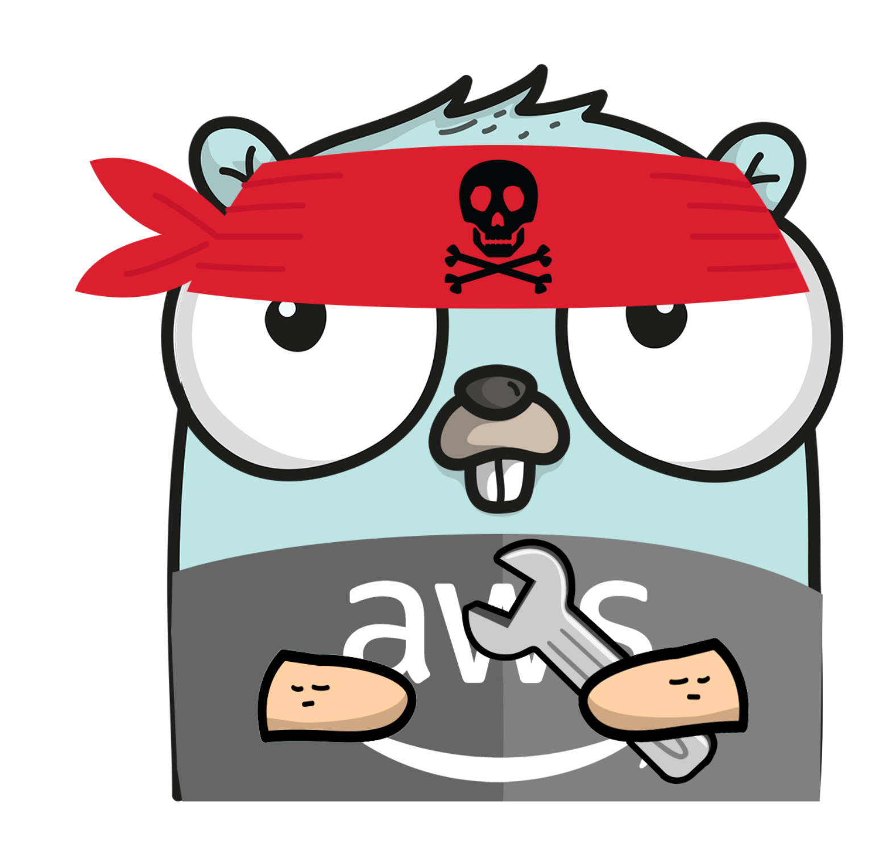

<p align="center"></p>
<p align="center">

</p>

# AWS Private CA Issuer

AWS Private CA Issuer is a [cert-manager](https://cert-manager.io/) [external issuer](https://cert-manager.io/docs/configuration/external/) for [AWS Private CA](https://aws.amazon.com/private-ca/).
Create an `AWSPCAIssuer` or `AWSPCAClusterIssuer` that points at your private CA, and cert-manager can issue certificates from it.

> [!TIP]
> Amazon EKS also provides AWS Private CA Issuer as the EKS add-on `aws-privateca-connector-for-kubernetes`.
> See [AWS add-ons](https://docs.aws.amazon.com/eks/latest/userguide/workloads-add-ons-available-eks.html#add-ons-aws-privateca-connector).

## Setup

[Install cert-manager](https://cert-manager.io/docs/installation/) first.

Then install AWS Private CA Issuer using Helm:

```shell
helm repo add awspca https://cert-manager.github.io/aws-privateca-issuer
helm install aws-privateca-issuer awspca/aws-privateca-issuer \
  --namespace aws-privateca-issuer --create-namespace
```

Then, on Amazon EKS, [configure EKS Pod Identity](docs/iam.md#eks-pod-identity) for the controller.
On other clusters, see [IAM](docs/iam.md) for IRSA and IAM Roles Anywhere.
See the [chart README](charts/aws-pca-issuer/README.md) for its values.

### Upgrading

Helm [does not upgrade CRDs](https://helm.sh/docs/topics/charts/#limitations-on-crds), so apply `charts/aws-pca-issuer/crds/` before upgrading.
Otherwise the API server rejects or silently drops new fields such as `serviceAccountRef`, and an Issuer that loses it falls back to [ambient credentials](docs/iam.md#ambient-credentials) where they are allowed.

> [!WARNING]
> As of v1.12.0, an `AWSPCAIssuer` doesn't use the controller's own AWS credentials (EKS Pod Identity, IRSA, IAM Roles Anywhere, or the instance profile) unless the chart's `enableIssuerAmbientCredentials` is `true`; it defaults to `false`.
> Before upgrading, choose how `AWSPCAIssuers` get AWS credentials:
> - **Central identity:** set `enableIssuerAmbientCredentials: true`.
>   Every `AWSPCAIssuer` shares the controller's credentials, so anyone who can create an `AWSPCAIssuer` can issue certificates from any CA the controller's role allows.
> - **Per-Issuer identity:** give each `AWSPCAIssuer` a `serviceAccountRef`, so it uses its own IAM role through IRSA, as described in [IRSA per Issuer](docs/iam.md#irsa-per-issuer).
>
> See [Recommended setup](docs/iam.md#recommended-setup).

## Usage

An Issuer names the private CA that signs certificates, and tells the controller how to get AWS credentials for it:

```yaml
apiVersion: awspca.cert-manager.io/v1beta1
kind: AWSPCAClusterIssuer
metadata:
  name: example
spec:
  # The ARN of the AWS Private CA that signs certificates, and its region.
  arn: arn:aws:acm-pca:us-west-2:111122223333:certificate-authority/<uuid4>
  region: us-west-2
  # Optional. An IAM role to assume before calling AWS Private CA.
  # role: arn:aws:iam::111122223333:role/pca-issuer
  # Optional. A ServiceAccount whose token is exchanged for `role` through IRSA.
  # serviceAccountRef:
  #   name: pca-issuer
  #   namespace: team-a
```

An `AWSPCAIssuer` is namespaced, and `Certificates` in its namespace can reference it.
An `AWSPCAClusterIssuer` has the same spec, isn't namespaced, and `Certificates` in any namespace can reference it.
An `AWSPCAClusterIssuer` uses the controller's own credentials unless it sets `serviceAccountRef` or `secretRef`, as in the [examples](config/examples/).
An `AWSPCAIssuer` needs its own credentials by default, as in [IRSA per Issuer](docs/iam.md#irsa-per-issuer).
See [IAM](docs/iam.md) for how each Issuer gets credentials.

### Setting NotBefore on issued certificates

The controller sets `NotBefore` on issued certificates to 15 minutes before issuance time, rather than AWS Private CA's default of 1 hour, to allow for clock skew across machines.
To change it, set `spec.notBeforeOffset` to a duration such as `30s` or `1h30m`, well below the certificate's duration, and at most 24 hours.
For instance, if you set the offset to 1h when working with istio + ztunnel and requesting 1h certificates, ztunnel would constantly request certificates.
See [issuer-with-not-before-offset.yaml](config/examples/config/issuer-with-not-before-offset.yaml).

### Usage with cert-manager ingress annotations

The `cert-manager.io/cluster-issuer` annotation cannot be used to point at an `AWSPCAClusterIssuer`.
Instead, set `cert-manager.io/issuer` to the Issuer's name, with `cert-manager.io/issuer-kind` set to `AWSPCAIssuer` or `AWSPCAClusterIssuer` and `cert-manager.io/issuer-group` set to `awspca.cert-manager.io`.
Without the kind, cert-manager sets `kind: Issuer`, and the controller marks the request Failed.
See [this issue](https://github.com/cert-manager/aws-privateca-issuer/issues/252) for more information.

## Supported workflows

AWS Private CA Issuer supports:

* AWS credentials from [EKS Pod Identity](docs/iam.md#eks-pod-identity), [IRSA](https://docs.aws.amazon.com/eks/latest/userguide/iam-roles-for-service-accounts.html) for the controller or [per Issuer](docs/iam.md#irsa-per-issuer), and [IAM Roles Anywhere](docs/iam.md#iam-roles-anywhere).
  Using AWS access keys from a Kubernetes `Secret` is [deprecated](docs/iam.md#not-recommended).
* CAs in other accounts, shared through AWS RAM or used through another role, as described in [CAs in other accounts](docs/iam.md#cas-in-other-accounts).
* All [AWS Private CA certificate templates](#using-aws-private-ca-templates).

## Using AWS Private CA templates

An Issuer can set a default template in `spec.pcaTemplate.defaultTemplateName`, from the [AWS Private CA certificate templates](https://docs.aws.amazon.com/acm-pca/latest/userguide/UsingTemplates.html#template-varieties).
The field takes the template's name, the part of the ARN after `:::template/`.
For `arn:aws:acm-pca:::template/SubordinateCACertificate_PathLen1/V1`, set `SubordinateCACertificate_PathLen1/V1`.
See [issuer-with-template.yaml](config/examples/config/issuer-with-template.yaml).

Every certificate request to that Issuer then uses the template, whatever usages the `Certificate` sets.
A default template limits every namespace that uses the Issuer to that template.

Without a default template, the controller picks one from the `Certificate`:

| cert-manager `Certificate` | AWS Private CA template |
| ------------------------ | ----------------------- |
| `isCA: true`             | `SubordinateCACertificate_PathLen0/V1` |
| CodeSigning              | `CodeSigningCertificate/V1` |
| ClientAuth               | `EndEntityClientAuthCertificate/V1` |
| ServerAuth               | `EndEntityServerAuthCertificate/V1` |
| OCSPSigning              | `OCSPSigningCertificate/V1` |
| ClientAuth, ServerAuth   | `EndEntityCertificate/V1` |
| Everything else          | `BlankEndEntityCertificate_APICSRPassthrough/V1` |

## Troubleshooting

If an Issuer is not ready, check its `Ready` condition with `kubectl describe`, and the controller's logs, where `sts:GetCallerIdentity` shows the AWS identity it uses for the Issuer.
See [IAM](docs/iam.md) for how to give the controller and its Issuers AWS credentials.

## Further reading

- [Setting up end-to-end TLS encryption on Amazon EKS with the AWS Load Balancer Controller](https://aws.amazon.com/blogs/containers/setting-up-end-to-end-tls-encryption-on-amazon-eks-with-the-new-aws-load-balancer-controller/)
- [TLS-enabled Kubernetes clusters with AWS Private CA and Amazon EKS](https://aws.amazon.com/blogs/security/tls-enabled-kubernetes-clusters-with-acm-private-ca-and-amazon-eks-2/)

## Help & feedback

For help, please consider the following venues (in order):

* Check the [Troubleshooting section](#troubleshooting)
* [Search open issues](https://github.com/cert-manager/aws-privateca-issuer/issues)
* [File an issue](https://github.com/cert-manager/aws-privateca-issuer/issues/new)
* Please ask questions in the slack channel [#cert-manager-aws-privateca-issuer](https://kubernetes.slack.com/archives/C02FEDR3FN2)

## Contributing

We welcome community contributions and pull requests.

See our [contribution guide](CONTRIBUTING.md) for more information on how to report issues, set up a development environment, and submit code.

We adhere to the [Amazon Open Source Code of Conduct](https://aws.github.io/code-of-conduct).
